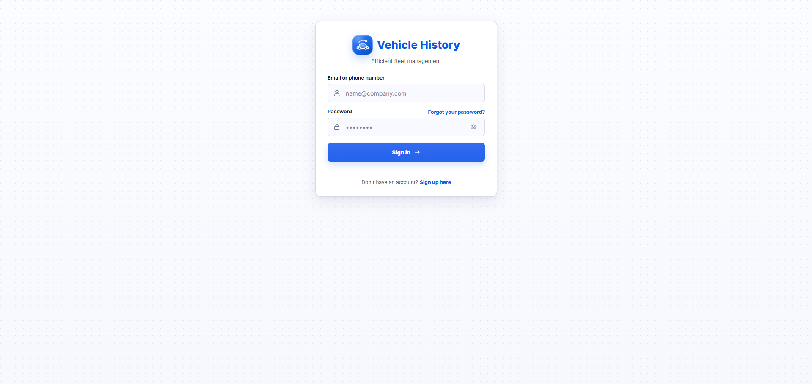
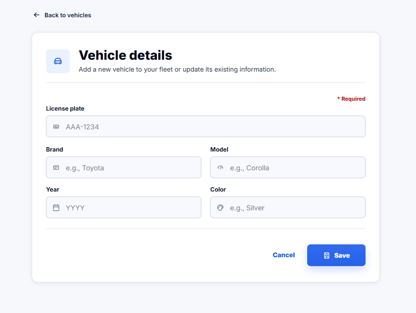
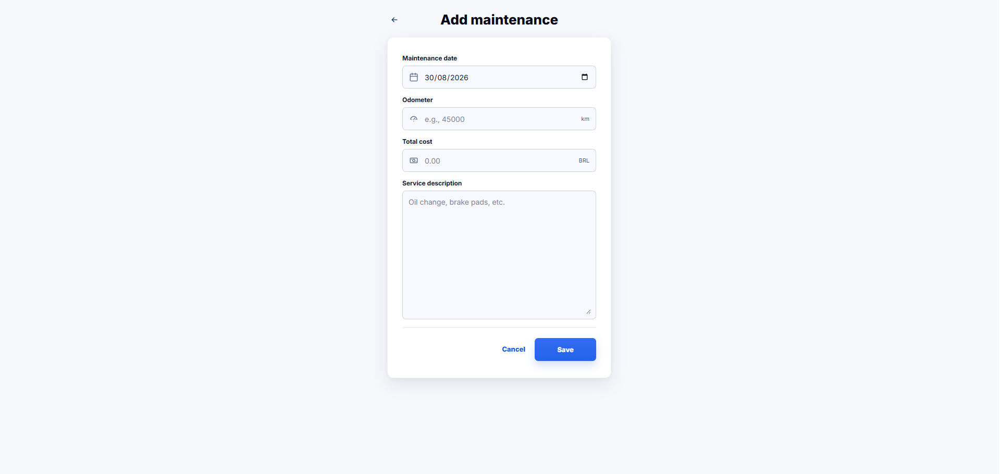

# Vehicle Maintenance History

[](https://github.com/mmetznerm/vehicle-maintenance-history/actions/workflows/ci-cd.yml)


Portfolio project for recording a vehicle's maintenance history. It provides a web application and REST API where users can create an account, register vehicles, and manage each vehicle's maintenance records.

[Mobile app](https://github.com/mmetznerm/vehicle-maintenance-history-kmp)

> The live demo is temporarily offline to control cloud costs. Screenshots below use fictitious data.

## Highlights

- User registration, login, JWT authentication, refresh tokens, and logout
- Vehicle and maintenance CRUD operations
- React web interface served with the Spring Boot application
- OpenAPI/Swagger documentation, Flyway migrations, health endpoint, and automated tests

## Stack

**Backend:** Java 21, Spring Boot, Spring Security, Spring Data JPA, PostgreSQL, Flyway, JWT, OpenAPI, Testcontainers, and Docker.

**Web:** React, TypeScript, Vite, and Vitest.

## Deployment

The application is containerized with Docker and deployed through GitHub Actions to AWS. The production setup uses Amazon ECR, EC2, RDS, and Systems Manager, with GitHub OIDC instead of long-lived cloud credentials. See the [deployment guide](docs/aws-deployment.md) for the architecture and operational notes.

## Screenshots






## Run locally

The quickest way to start the complete application is Docker:

```bash
docker compose up --build
```

Then open:

- App: `http://localhost:8080`
- API docs: `http://localhost:8080/swagger-ui.html`
- Health: `http://localhost:8080/actuator/health`

## Tests

```bash
cd backend
.\mvnw.cmd test
```

Integration tests require Docker because they use Testcontainers:

```bash
.\mvnw.cmd verify -Pintegration-tests
```

## Notes

The repository also contains deployment and architecture notes in [`docs`](docs). The next product step is to connect the companion Kotlin Multiplatform mobile app to this API end to end.
