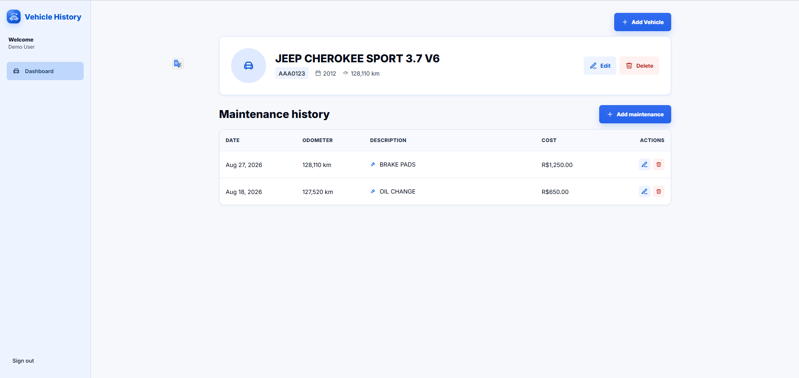

# Vehicle Maintenance History

[](https://github.com/mmetznerm/vehicle-maintenance-history/actions/workflows/ci-cd.yml)


Portfolio project for recording a vehicle's maintenance history. It provides a web application and REST API where users can create an account, register vehicles, and manage each vehicle's maintenance records.

[📱 Companion Mobile App (Kotlin Multiplatform)](https://github.com/mmetznerm/vehicle-maintenance-history-kmp)

> The live demo is temporarily offline to control cloud costs. Screenshots below use fictitious data.

## Highlights

- User registration, login, JWT authentication, refresh tokens, and logout
- Vehicle and maintenance CRUD operations
- React web interface served with the Spring Boot application
- OpenAPI/Swagger documentation, Flyway migrations, health endpoint, and automated tests

## Stack

- **Backend:** Java 21, Spring Boot 3.5, Spring Security (JWT), Spring Data JPA, PostgreSQL, Flyway Migrations, SpringDoc OpenAPI (Swagger UI), Lombok, Spring Boot Actuator.
- **Web Frontend:** React 19, TypeScript, Vite, Vitest, ESLint.
- **Testing & Quality:** JUnit 5, Spring Security Test, Testcontainers (PostgreSQL integration tests), JaCoCo Code Coverage (min 60% ratio rule), CodeQL SAST.
- **DevOps & Cloud Infrastructure:** Docker, Multi-stage Dockerfile, Docker Compose, GitHub Actions CI/CD, AWS (EC2, ECR, RDS, Systems Manager/SSM, OIDC authentication).

## CI/CD & Automated Quality Gates

Every push and pull request executes an automated 8-job pipeline:

1. **Backend Unit Tests:** Executes unit tests with Maven and enforces JaCoCo line coverage verification.
2. **Backend Integration Tests:** Runs integration tests (`*IT.java`) against a real PostgreSQL instance managed via Testcontainers.
3. **CodeQL (Java/Kotlin):** Static Application Security Testing (SAST) for backend vulnerability scanning.
4. **CodeQL (JavaScript/TypeScript):** Security analysis for the React frontend.
5. **Frontend Quality:** Automated ESLint linting, Vitest unit testing with coverage checks, and Vite build verification.
6. **Deployment Contracts:** ShellCheck analysis for deployment shell scripts, actionlint for GitHub Actions workflows, and Docker Compose validation.
7. **Publish Docker Image:** Automated Docker buildx multi-stage build, published to Docker Hub & Amazon ECR using GitHub Actions AWS OIDC authentication (short-lived cloud credentials).
8. **Deploy to EC2 via SSM:** Automated zero-downtime deployment executed on AWS EC2 through AWS Systems Manager (SSM) with polling status verification.

## Deployment

The application is containerized with Docker and deployed through GitHub Actions to AWS. The production setup uses Amazon ECR, EC2, RDS, and Systems Manager, with GitHub OIDC instead of long-lived cloud credentials. See the [deployment guide](docs/aws-deployment.md) for the architecture and operational notes.

## Screenshots





## Run locally

The quickest way to start the complete application is Docker:

```bash
docker compose up --build
```

Then open:

- App: `http://localhost:8080`
- API docs: `http://localhost:8080/swagger-ui.html`
- Health: `http://localhost:8080/actuator/health`

## Tests

```bash
cd backend
.\mvnw.cmd test
```

Integration tests require Docker because they use Testcontainers:

```bash
.\mvnw.cmd verify -Pintegration-tests
```

## Notes

The repository also contains deployment and architecture notes in [`docs`](docs). The next product step is to connect the companion Kotlin Multiplatform mobile app to this API end to end.
