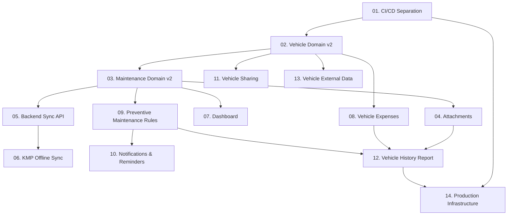

# Product Roadmap — Vehicle Maintenance History

O **Vehicle Maintenance History** é uma plataforma orientada a produção para gestão completa do histórico de manutenção, custos, relatórios e compartilhamento de veículos.

> 📌 **Fonte de Verdade para o Status Operacional**: O acompanhamento do status em tempo real de cada estória (`BACKLOG`, `READY`, `IN PROGRESS`, `BLOCKED`, `DONE`) é gerenciado no **[GitHub Project: Vehicle Maintenance History — Roadmap](https://github.com/users/mmetznerm/projects)** e nas **[GitHub Issues](https://github.com/mmetznerm/vehicle-maintenance-history/issues)**.

Este documento consolida o **Roadmap Técnico do Produto**, organizado em **14 estórias verticais completas**. Cada estória é projetada para entregar valor de ponta a ponta (Backend, Web e Mobile KMP), mantendo a arquitetura limpa e incremental.

---

## Visão Arquitetural

### Backend
- **Monólito Modular Spring Boot 3.5 (Java 21)**.
- Organizado por módulos funcionais em `com.mmetzner.vmh`:
  ```text
  backend/vmh
  ├── auth          # Autenticação JWT e Refresh Tokens
  ├── user          # Gestão de usuários e perfis
  ├── vehicle       # Cadastro e gestão expandida de veículos
  ├── maintenance   # Registro detalhado de manutenções
  ├── attachment    # Gestão de fotos, notas e documentos
  ├── expense       # Controle de despesas gerais do veículo
  ├── reminder      # Regras e motor de lembretes/notificações
  ├── sharing       # Compartilhamento e permissões (Owner, Editor, Viewer)
  ├── dashboard     # Agregações e métricas do painel principal
  ├── report        # Geração de relatórios consolidados em PDF
  └── shared        # Utilitários, excepções globais e configurações de segurança
  ```

### Mobile
- **Kotlin Multiplatform (KMP) + Compose Multiplatform** (Android & iOS).
- Arquitetura **Local-First / Offline-First** usando **Room Multiplatform**, **Outbox Pattern** e cliente HTTP **Ktor**.

### Infraestrutura & AWS
- Desenvolvimento local e CI 100% funcionais **sem dependência da AWS**.
- Infraestrutura AWS (EC2, ECR, RDS, SSM, OIDC) mantida e documentada como capacidade de publicação/CD para quando o produto estiver pronto para produção.

---

## Lista Sequencial de Estórias

| # | Estória | Issue | Status Inicial | Resumo do Escopo |
|---|---|:---:|:---:|---|
| **01** | [STORY-001 — Separar claramente CI de AWS/CD](stories/STORY-001-ci-cd-separation.md) | [#76](https://github.com/mmetznerm/vehicle-maintenance-history/issues/76) | `READY` | Desacoplar CI do AWS/ECR/EC2; garantir builds, testes e SAST sem conta AWS ativa. |
| **02** | [STORY-002 — Vehicle Domain v2](stories/STORY-002-vehicle-domain-v2.md) | [#77](https://github.com/mmetznerm/vehicle-maintenance-history/issues/77) | `BACKLOG` | Evoluir o domínio de veículo com marca, modelo, versão, ano, placa, VIN/chassi, cor, km e notas. |
| **03** | [STORY-003 — Maintenance Domain v2](stories/STORY-003-maintenance-domain-v2.md) | [#78](https://github.com/mmetznerm/vehicle-maintenance-history/issues/78) | `BACKLOG` | Categorias de manutenção, detalhamento de mão de obra e peças, oficina, mecânico, garantia e cálculo de total. |
| **04** | [STORY-004 — Attachments, Photos and Documents](stories/STORY-004-attachments-photos-documents.md) | [#79](https://github.com/mmetznerm/vehicle-maintenance-history/issues/79) | `BACKLOG` | Anexo de fotos, notas e documentos com abstração `FileStorage` (`LocalFileStorage` local e `S3FileStorage` prod). |
| **05** | [STORY-005 — Backend Sync API](stories/STORY-005-backend-sync-api.md) | [#80](https://github.com/mmetznerm/vehicle-maintenance-history/issues/80) | `BACKLOG` | Endpoints idempotentes de sincronização para suportar o Outbox Pattern do app mobile. |
| **06** | [STORY-006 — KMP Offline Sync](stories/STORY-006-kmp-offline-sync.md) | [#81](https://github.com/mmetznerm/vehicle-maintenance-history/issues/81) | `BACKLOG` | Motor de sincronização offline bidirecional em KMP com Room, Outbox, retries e WorkManager/iOS tasks. |
| **07** | [STORY-007 — Dashboard](stories/STORY-007-dashboard.md) | [#82](https://github.com/mmetznerm/vehicle-maintenance-history/issues/82) | `BACKLOG` | Painel de controle com agregações reais (total de veículos, manutenções, gastos, próximas manutenções). |
| **08** | [STORY-008 — Vehicle Expenses](stories/STORY-008-vehicle-expenses.md) | [#83](https://github.com/mmetznerm/vehicle-maintenance-history/issues/83) | `BACKLOG` | Controle de custos não-manutenção (combustível, IPVA/impostos, seguro, pedágio) e cálculo de custo/km. |
| **09** | [STORY-009 — Preventive Maintenance Rules](stories/STORY-009-preventive-maintenance-rules.md) | [#84](https://github.com/mmetznerm/vehicle-maintenance-history/issues/84) | `BACKLOG` | Regras de manutenção preventiva por intervalo de km/tempo com cálculo de status (OK, Próxima, Vencida). |
| **10** | [STORY-010 — Notifications and Reminders](stories/STORY-010-notifications-and-reminders.md) | [#85](https://github.com/mmetznerm/vehicle-maintenance-history/issues/85) | `BACKLOG` | Gerador de lembretes e integração com notificações locais push no Android e iOS. |
| **11** | [STORY-011 — Vehicle Sharing and Permissions](stories/STORY-011-vehicle-sharing-and-permissions.md) | [#86](https://github.com/mmetznerm/vehicle-maintenance-history/issues/86) | `BACKLOG` | Compartilhamento de veículos com controle de acesso granular (`OWNER`, `EDITOR`, `VIEWER`). |
| **12** | [STORY-012 — Vehicle History Report](stories/STORY-012-vehicle-history-report.md) | [#87](https://github.com/mmetznerm/vehicle-maintenance-history/issues/87) | `BACKLOG` | Relatório consolidado em PDF com linha do tempo de manutenções e histórico do veículo para venda/guarda. |
| **13** | [STORY-013 — Vehicle External Data](stories/STORY-013-vehicle-external-data.md) | [#88](https://github.com/mmetznerm/vehicle-maintenance-history/issues/88) | `BACKLOG` | Consulta externa de veículos por placa/VIN, especificações técnicas e manutenção recomendada. |
| **14** | [STORY-014 — Production Infrastructure](stories/STORY-014-production-infrastructure.md) | [#89](https://github.com/mmetznerm/vehicle-maintenance-history/issues/89) | `BACKLOG` | Reativação da infraestrutura AWS, HTTPS, observabilidade CloudWatch, backups RDS e deploys contínuos. |

---

## Mapa de Dependências Técnicas



---

## Como Executar Estórias

Para iniciar o desenvolvimento da próxima estória pendente, basta enviar no chat o comando:

> **"Comece a próxima estória"**

O agente seguirá o protocolo operacional definido em [`docs/stories/README.md`](stories/README.md).
