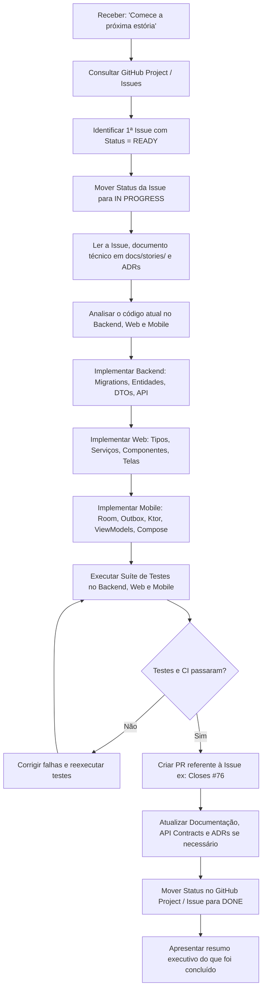

# Guia de Operação e Gestão de Estórias — Vehicle Maintenance History

Este repositório utiliza **GitHub Projects + GitHub Issues** como fonte de verdade para o status operacional e acompanhamento do desenvolvimento do produto, mantendo a documentação técnica nos próprios repositórios.

O produto é composto por dois repositórios integrados:
- **Backend + Web**: [`vehicle-maintenance-history`](https://github.com/mmetznerm/vehicle-maintenance-history)
- **Mobile KMP**: [`vehicle-maintenance-history-kmp`](https://github.com/mmetznerm/vehicle-maintenance-history-kmp)

---

## 1. Fonte de Verdade e Separação de Responsabilidades

| Camada | Ferramenta / Local | Descrição |
|---|---|---|
| **Status Operacional** | GitHub Project (`Vehicle Maintenance History — Roadmap`) | Status das estórias (`BACKLOG`, `READY`, `IN PROGRESS`, `BLOCKED`, `DONE`), prioridades e áreas. |
| **Acompanhamento das Estórias** | GitHub Issues (`mmetznerm/vehicle-maintenance-history`) | Cada Issue representa uma grande estória vertical de produto/engenharia. |
| **Contexto Técnico da Estória** | [`docs/stories/STORY-XXX-*.md`](.) | Especificação detalhada da estória, escopo Backend/Web/Mobile, critérios de aceite e DoD. |
| **Decisões de Arquitetura** | [`docs/adr/`](../adr/) | Registros de Decisão Arquitetural (ADRs). |
| **Código Fonte** | Repositórios Git | Implementação física (Java/Spring Boot, React 19, Kotlin Multiplatform). |
| **Implementação e Review** | Pull Requests (PRs) | Alterações propostas ligadas à Issue correspondente (`Closes #123`). |
| **Qualidade e Validação** | GitHub Actions | Workflows de CI/CD automatizados (testes unitários, integração, SAST e linter). |

---

## 2. Estrutura do GitHub Project & Issues

### Projeto Único de Produto
- **Nome**: `Vehicle Maintenance History — Roadmap`
- **Repositórios Acompanhados**: `vehicle-maintenance-history` e `vehicle-maintenance-history-kmp`

### Status Válidos
- `BACKLOG`: Estória planejada, aguardando pré-requisitos/dependências.
- `READY`: Estória pronta para desenvolvimento (contexto e dependências resolvidas).
- `IN PROGRESS`: Estória atualmente em desenvolvimento (máximo 1 estória por vez).
- `BLOCKED`: Estória impedida por dependência ou problema identificado.
- `DONE`: Estória completamente concluída (código, testes, CI e documentação).

### Campos Personalizados
- **Area**: `Backend`, `Web`, `Mobile`, `Cross-platform`, `Architecture`, `Infrastructure`
- **Priority**: `P0`, `P1`, `P2`, `P3`

---

## 3. Comandos Operacionais da IA

O agente de IA ou desenvolvedor deve responder estritamente aos seguintes comandos no chat:

### 🟢 Comando: `"Comece a próxima estória"`

Quando este comando for enviado:

#### Passos Executados pela IA:
1. **Passo 1**: Consultar o GitHub Project e listar as Issues com `Status = READY`.
2. **Passo 2**: Selecionar a Issue pronta de menor número sequencial (ex: `STORY-001`). Não escolher estórias aleatórias.
3. **Passo 3**: Atualizar o status da estória para `IN PROGRESS` no GitHub Project.
4. **Passo 4**: Ler a Issue no GitHub, a documentação técnica correspondente (`docs/stories/STORY-XXX-....md`), ADRs relacionados e o código atual.
5. **Passo 5**: Implementar a estória de ponta a ponta (Backend, Web, Mobile, Migrations, Testes).
6. **Passo 6**: Executar todas as suítes de teste (Backend `./mvnw verify -Pintegration-tests`, Web `npm run test:coverage`, Mobile `./gradlew :composeApp:allTests`).
7. **Passo 7**: Criar o Pull Request referenciando a Issue (`Closes #123`).
8. **Passo 8**: Atualizar a documentação do repositório se necessário.
9. **Passo 9**: Mover o status da estória para `DONE` e fechar a Issue somente quando a DoD estiver 100% cumprida.

---

### 🟡 Comando: `"Continue a estória atual"`

Quando este comando for enviado:
1. Consultar o GitHub Project e identificar a estória com status `IN PROGRESS`.
2. Ler os Pull Requests abertos e o estado atual do código para retomar exatamente do ponto onde parou.
3. Finalizar a implementação, passar nos testes e marcar como `DONE`.

---

### 🔵 Comando: `"Qual é o status do projeto?"`

Quando este comando for enviado:
1. Consultar o GitHub Project e listar o status real de todas as estórias.
2. Retornar um relatório sintetizado contendo:
   - **Estória Atual (IN PROGRESS)**
   - **Próximas Prontas (READY)**
   - **Bloqueadas (BLOCKED)**
   - **Concluídas (DONE)**
   - **No Backlog (BACKLOG)**
3. Nunca inventar status ou consultar sistemas externos como Trello/Notion.

---

## 4. Regra de Execução Única (Single In Progress Rule)

- Em qualquer momento, no máximo **1 Estória** pode estar em `IN PROGRESS`.
- Caso a estória em andamento seja bloqueada por dependência externa ou impedimento técnico:
  - Alterar o status no GitHub Project de `IN PROGRESS` para `BLOCKED`.
  - Adicionar a label `blocked` e um comentário explicativo na Issue.
  - A próxima estória disponível com status `READY` poderá então ser iniciada.

---

## 5. Definition of Done (DoD) Global

Uma estória **SÓ PODE** ser marcada como `DONE` quando todos os itens abaixo forem atendidos:

- [ ] Requisitos funcionais e critérios de aceite da estória implementados.
- [ ] Banco de dados/Migrations Flyway criados e testados com sucesso.
- [ ] Backend Spring Boot atualizado com validações, tratamento de exceções e log estruturado.
- [ ] Frontend Web (React 19) implementado com suporte aos novos fluxos e componentes responsivos.
- [ ] Mobile KMP (Android/iOS) atualizado com suporte local-first (Room/Outbox) e UI Compose.
- [ ] Suíte de testes unitários e de integração passando sem falhas (Backend, Web e Mobile).
- [ ] CI local e remoto executando sem erros.
- [ ] NENHUM segredo, senha ou token exposto em código ou arquivos de configuração.
- [ ] Documentação de API (Swagger, Postman) e ADRs atualizadas conforme necessário.
- [ ] Pull Request criado e vinculado à Issue (`Closes #XXX`).
- [ ] Status da estória no GitHub Project e Issue atualizado para `DONE`.
