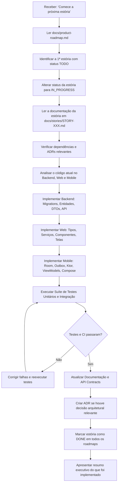

# Guia de Execução de Estórias — Vehicle Maintenance History

Este repositório utiliza um fluxo de desenvolvimento guiado por estórias verticais completas.

Cada estória documentada no roadmap representa uma entrega funcional completa que engloba **Backend**, **Web (React)** e **Mobile (Kotlin Multiplatform)** quando aplicável.

---

## 1. O Comando "Comece a próxima estória"

Quando o comando abaixo for emitido no chat:

> **"Comece a próxima estória"**

O agente de IA ou desenvolvedor responsável DEVE seguir estritamente o algoritmo de execução abaixo.

---

## 2. Algoritmo de Execução Passo a Passo



### Detalhamento das Etapas:

1. **Localização**:
   - Inspecione [`docs/product-roadmap.md`](../product-roadmap.md) e a pasta [`docs/stories/`](.) para localizar a estória não concluída com menor número sequencial (status `[TODO]`).
2. **Mudança de Estado Inicial**:
   - Atualize a estória selecionada para `[IN_PROGRESS]` no arquivo da estória, no [`product-roadmap.md`](../product-roadmap.md) e no [`mobile-roadmap.md`](../../vehicle-maintenance-history-kmp/docs/mobile-roadmap.md).
3. **Análise de Contexto**:
   - Leia atentamente a especificação completa da estória (`STORY-XXX.md`), critérios de aceite, escopos e limitações.
   - Inspecione a base de código existente para garantir compatibilidade.
4. **Execução Vertical**:
   - **Banco de Dados / Flyway**: Crie as migrations versionadas (`V6__...`, `V7__...`) com suporte a Rollback e integridade referencial.
   - **Backend**: Implemente/evolua o módulo Spring Boot em `com.mmetzner.vmh.<modulo>`, mantendo a arquitetura de Monólito Modular.
   - **Web**: Atualize a interface React 19 em `frontend/src/`, incluindo chamadas de API, tipos TypeScript, validações e componentes responsivos.
   - **Mobile**: Atualize a aplicação Kotlin Multiplatform em `composeApp/src/commonMain/`, ajustando Room entities, Outbox operations, endpoints Ktor e telas Compose Multiplatform.
5. **Verificação Qualitativa e Automatizada**:
   - Execute os testes do backend:
     ```bash
     cd backend && ./mvnw verify -Pintegration-tests
     ```
   - Execute os testes do frontend:
     ```bash
     cd frontend && npm run lint && npm run test:coverage && npm run build
     ```
   - Execute os testes do mobile:
     ```bash
     cd vehicle-maintenance-history-kmp && ./gradlew :composeApp:allTests
     ```
6. **Atualização da Documentação**:
   - Atualize os contratos Swagger/OpenAPI e a coleção Postman (`docs/api/vehicle-maintenance-api.postman_collection.json`) se houve mudança na API.
   - Se uma decisão arquitetural significativa foi tomada, crie um novo ADR em `docs/adr/`.
7. **Finalização**:
   - Marque a estória como `[DONE]` no arquivo da estória e nos dois roadmaps (`product-roadmap.md` e `mobile-roadmap.md`).
   - Apresente um resumo detalhado das alterações, incluindo arquivos modificados e resultado dos testes.

---

## 3. Definition of Done (DoD) Global

Uma estória **SÓ PODE** ser marcada como `[DONE]` quando todos os itens abaixo forem atendidos:

- [ ] Requisitos funcionais e critérios de aceite da estória implementados.
- [ ] Banco de dados/Migrations Flyway criados e testados com sucesso.
- [ ] Backend Spring Boot atualizado com validações, tratamento de exceções e log estruturado.
- [ ] Frontend Web (React 19) implementado com suporte aos novos fluxos e componentes responsivos.
- [ ] Mobile KMP (Android/iOS) atualizado com suporte local-first (Room/Outbox) e UI Compose.
- [ ] Suíte de testes unitários e de integração passando sem falhas (Backend, Web e Mobile).
- [ ] CI/CD local e remoto executando sem erros.
- [ ] NENHUM segredo, senha ou token exposto em código ou arquivos de configuração.
- [ ] Documentação de API (Swagger, Postman) e ADRs atualizadas conforme necessário.
- [ ] Status da estória atualizado para `[DONE]` nos documentos de roadmap.

---

## 4. Regras Absolutas de Arquitetura

1. **Monólito Modular Spring Boot**: Não crie microserviços, filas Kafka ou instâncias Redis sem necessidade real justificada e documentada em ADR.
2. **Local-First no Mobile**: O aplicativo mobile deve sempre permitir leitura e escrita local via Room, enfileirando mutações no Outbox Pattern para sincronização com o backend.
3. **Desenvolvimento Local Independente da Cloud**: O ambiente local, os testes de integração (Testcontainers) e os pipelines CI devem rodar 100% sem dependência de contas ou credenciais AWS ativas.
4. **Sem Alterações Silenciosas na API**: Qualquer alteração em endpoints REST deve ser refletida na documentação e no cliente mobile KMP e web React simultaneamente.
